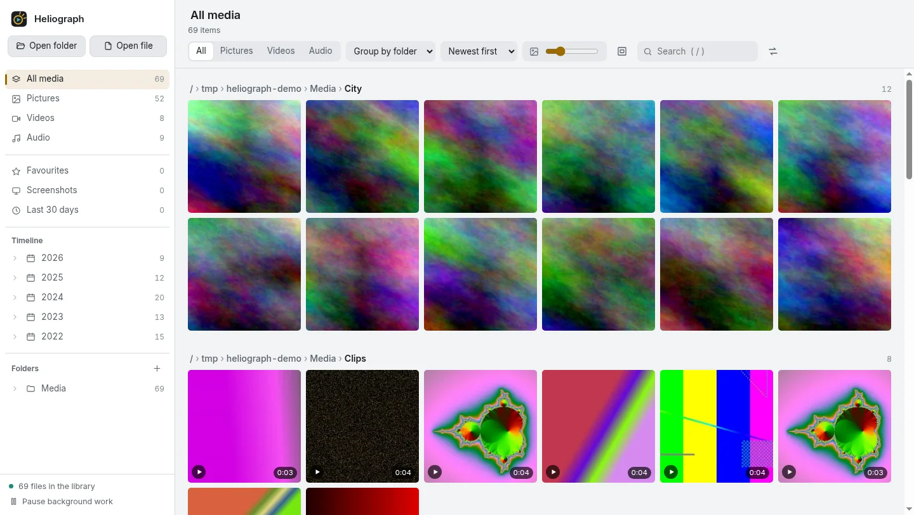
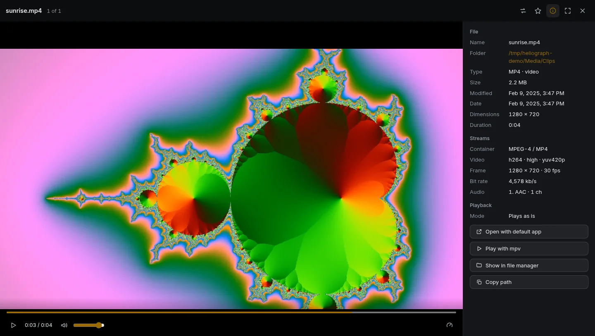
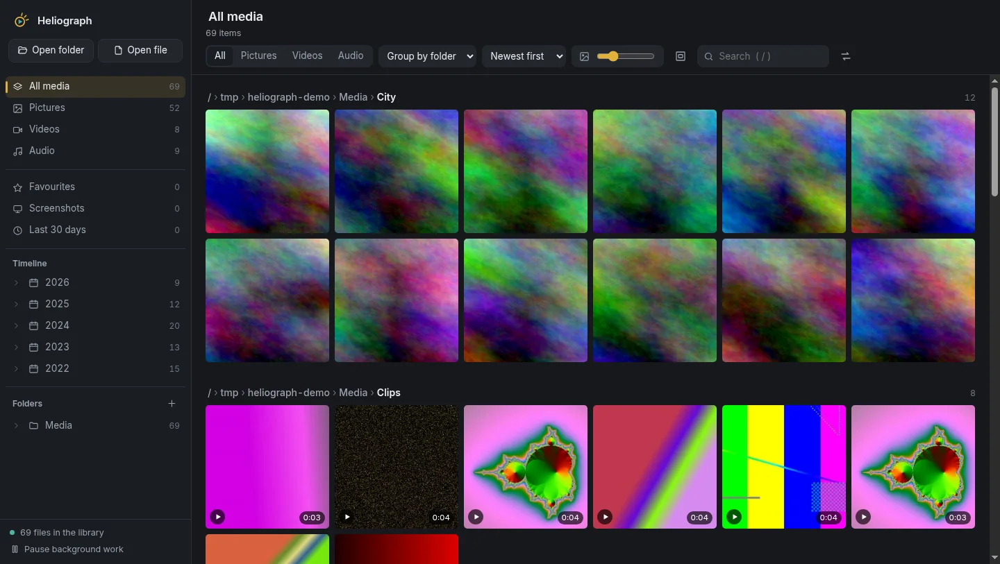

# Heliograph

**A fast, private media library and player for Linux.** Point it at a folder with 14,000 pictures and videos (or a million) and it opens at once, loads only what is on your screen, and keeps out of the PC's way.

[](https://github.com/md8-habibullah/heliograph/actions/workflows/ci.yml)
[](LICENSE)


<p align="center">
  
</p>

<p align="center">
  
  
</p>

<sub>Screenshots use generated sample media, not personal files.</sub>

## Why Heliograph

Most gallery apps try to read every file in a folder up front, so a big folder means minutes of disk and CPU use and a frozen desktop. Heliograph is built around the opposite rule: **do work only for what you are looking at, and only when the PC can afford it.**

- **Loads only the surface.** The picture grid is a true virtual grid: a 14,000-file folder is about 35 tiles in the page, however far you scroll. Thumbnails are requested for visible tiles only, nearest the centre first, and cancelled when you scroll past them. A fast fling loads nothing until it settles.
- **Calm by design.** A resource governor watches CPU, disk and memory pressure and the battery. Background reading pauses when the machine is busy, runs in short duty-cycled bursts when it is not, and works on a few files at a time.
- **Plays what browsers cannot.** MOV, MKV, AVI, WMV, MPEG, ProRes, 10-bit and HEVC files play in the built-in player: directly when possible, repackaged when only the container is wrong, and converted on the fly (GPU first, then CPU) when the codec is the problem.
- **Everything in one local database.** Folders, file details, favourites and settings live in a SQLite database (WAL mode, versioned schema). Thumbnails live in a separate, safe-to-delete cache database with a size limit. A damaged database is set aside and rebuilt from a small snapshot.
- **Open any folder or file.** Browse a folder just for now, or add it to the library. Open a single picture and the files next to it are one arrow key away.
- **Convert with FFmpeg.** 22 presets for pictures, video and audio, one job at a time at low priority, originals never touched.
- **Private and local.** It listens only on `127.0.0.1`, uses no network services, and has no telemetry. See [PRIVACY.md](PRIVACY.md).
- **Made for AI agents too.** A built-in [MCP server](docs/mcp.md) lets an assistant search and inspect your library, read-only unless you opt in. See [AGENTS.md](AGENTS.md).

## Requirements

| Need | For | Notes |
| --- | --- | --- |
| Linux, Python 3.10+ | everything | Developed on Python 3.14; CI runs 3.10 to 3.14 |
| `ffmpeg` and `ffprobe` | video and audio details, thumbnails, playback fallback, conversion | Strongly recommended. Without it only pictures work well |
| A Chromium-based browser | the window | Brave, Chromium, Chrome, Edge or Vivaldi; it runs in app mode (no tabs, no address bar). Set `HELIOGRAPH_BROWSER` to choose one |
| Pillow (`pip install "heliograph[image]"`) | fast picture headers and thumbnails | Optional: ImageMagick and FFmpeg are the fallback |
| ImageMagick, `heif-convert`, `dcraw_emu` | extra picture formats (RAW, HEIC, ...) | Optional, used when present |

Heliograph has **no required Python packages**.

## Install

From a source checkout (no installation needed):

```bash
git clone https://github.com/md8-habibullah/heliograph.git
cd heliograph
./bin/heliograph ~/Pictures
```

As a command, with pipx:

```bash
pipx install "heliograph[image] @ git+https://github.com/md8-habibullah/heliograph.git"
heliograph install          # adds Heliograph to the app menu and to "Open with"
```

On Arch Linux, a `PKGBUILD` is in [packaging/](packaging/).

`heliograph install` only adds a launcher and an icon under `~/.local/share`. It never changes your default applications. Window behaviour on Wayland (Hyprland) is described in the [FAQ](docs/faq.md).

## Use it

```bash
heliograph ~/Pictures            # browse a folder (just for now)
heliograph --add ~/Pictures      # add it to your library
heliograph photo.jpg             # view one file; arrow keys move through its folder
heliograph clip.mov              # play one file
heliograph                       # open the library window
```

In the window use **Open folder** (`Ctrl+O`) or **Open file** (`Ctrl+Shift+O`). Typed paths work, and the dialog offers your usual folders.

Make it the default viewer and player (undo any time):

```bash
heliograph default --images --videos --audio
heliograph default --restore
```

### Keyboard

Press `?` anywhere (or use **Help** at the bottom of the sidebar, or the `?` button in the viewer) to see this list in the window. **About** next to it says what Heliograph handles and who made it.

| Where | Keys |
| --- | --- |
| Library | Arrows, `PageUp`/`PageDown`, `Home`/`End` move; `Enter` opens; `Space` or `x` selects; `Ctrl+A` selects all; `Esc` clears; `/` searches; `?` help |
| Viewer, pictures | `←` `→` (or `PageUp` `PageDown`) previous / next; `Home` `End` first / last; `Z` or a click zooms to the original |
| Viewer, video (like YouTube) | `Space` or `K` play / pause; `←` `→` seek 5 s; `J` `L` seek 10 s; `↑` `↓` volume; `M` mute; `0`–`9` jump to 0–90 %; `Home` `End` start / end; `,` `.` one frame back / forward (files that play directly); `Shift+,` `Shift+.` slower / faster, 0.25× to 3.5×; `C` subtitles; `R` repeat; `F` or a double-click full screen. Use `PageUp` `PageDown` (or the on-screen buttons) for previous / next video |
| Viewer, music and audio | The same seek, volume, mute, `0`–`9`, speed (pitch stays the same) and repeat keys; `Shift+N` / `Shift+P` next / previous track (previous restarts a track that has played for more than 3 s). Music goes on to the next track by itself; keyboard media keys and desktop media controls work where the desktop supports them |
| Anywhere in the viewer | `F` full screen; `I` details; `S` favourite; `Shift+C` convert; `?` help; `Esc` closes |

### Command line

```bash
heliograph search holiday --kind image --json     # search the library (no service needed)
heliograph info clip.mov                          # what is inside a file and how it plays
heliograph convert --list                         # every conversion preset
heliograph convert --to mp4 --max-height 1080 --out ~/Videos/small *.mov
heliograph doctor                                 # check that everything works
heliograph monitor                                # live terminal status (progress, rates, CPU, memory)
heliograph config                                # list settings (background indexing, cache size, GPU use, ...)
heliograph config thumb_cache_mb 1024            # change one
heliograph cache --help                           # thumbnail cache size and clearing
heliograph stop                                   # stop the background service
```

## What it plays and shows

Heliograph recognises **249 file extensions** (121 picture, 65 video and 63 audio formats). The full list is in [docs/formats.md](docs/formats.md), together with how each family is handled and which paths have been tested on real files. Anything else FFmpeg or ImageMagick can read is a best-effort bonus, not a promise.

## Performance, measured

Measured on the development laptop (13th-gen Intel Core i5, 8 GB RAM, while it was also running other heavy jobs):

| Library | Result |
| --- | --- |
| 14,016 real files (13,406 pictures, 610 videos) | First screen requests about 31 thumbnails. Service stays near 80 MB RSS. A rapid 40-jump fling through the whole list requests nothing until it stops |
| 1,000,000 synthetic index rows | Page fetch 2 to 7 ms. Locate a file 7 to 11 ms. Timeline 3 ms. Folder tree 32 to 60 ms. About 100 to 120 MB RSS with six cached views |

The million-row library is synthetic (rows written straight to the database by [tools/synth_library.py](tools/synth_library.py)), so it measures the index, views and API, not thumbnail decoding. Method, caveats and how to reproduce are in [docs/performance.md](docs/performance.md). Please report your own numbers.

## For AI agents and contributors

- [AGENTS.md](AGENTS.md) is the entry point for coding agents (Claude Code, Codex, Cursor, Copilot, and others).
- [docs/ai/ARCHITECTURE.md](docs/ai/ARCHITECTURE.md) is the map of the code.
- [docs/mcp.md](docs/mcp.md) explains the MCP server: `heliograph mcp`.
- [llms.txt](llms.txt) summarises the project for language models.
- [CONTRIBUTING.md](CONTRIBUTING.md) explains how to build, test and send changes.

## Safety and privacy at a glance

- Listens on `127.0.0.1` only; checks the `Host` header and `Sec-Fetch-Site`; every API call needs a per-session token; a strict Content-Security-Policy; the interface never uses `innerHTML`.
- Files are served by database id, and only from folders you opened. System folders cannot be opened.
- The database, caches and logs are private to your user (directories `0700`, files `0600`).
- Conversion never overwrites or changes an original: output goes to a `.part` file and is renamed when complete.

Details: [SECURITY.md](SECURITY.md), [PRIVACY.md](PRIVACY.md).

## Status

Version 0.1.0, alpha. It has been tested against a real 14,000-file folder and a synthetic million-file index, and its window and command-line flow were checked on Hyprland (Wayland) with Brave and Chromium; other desktops have not been tried. It is young: please read [docs/formats.md](docs/formats.md) for what is untested, and open an issue for anything that misbehaves.

## License

[MIT](LICENSE) © 2026 MD. Habibullah Sharif
